# ADVENTIST UNIVERSITY OF CENTRAL AFRICA

P.O. Box 2461, Kigali, Rwanda | www.auca.ac.rw | info@auca.ac.rw

## INTERNSHIP REPORT ON THE AI RESUME SCREENING PLATFORM AT CODAFRIQA

**FACULTY:** Information Technology
**DEPARTMENT:** Information Management
**SUBMITTED BY:** SHYAKA Jospin
**STUDENT ID:** 26119
**INTERNSHIP PERIOD:** 17th August – 16th October, 2026
**HOST ORGANIZATION:** CODAFRIQA — AI-Driven Technology & Engineering for Africa
**SUPERVISOR:** IRANKUNDA BADAGA Steven

# DECLARATION

I, **SHYAKA Jospin**, declare that this internship report entitled **“AI Resume Screening Platform at CODAFRIQA”** is my original work carried out during my industrial attachment at **CODAFRIQA — AI-Driven Technology & Engineering for Africa**. This report has not been submitted elsewhere for any academic qualification.

This report is the result of the practical training, applied research, and hands-on software engineering experience I gained during the nine-week internship period. It accurately reflects the tasks assigned to me, the software engineering responsibilities I undertook, and the technical and professional knowledge I acquired throughout my engagement. All literature, tools, and technical resources utilized in the preparation of this report have been duly acknowledged.

**Signature:** ............................................................  
**Date:** ..................................................................

# APPROVAL

I, **IRANKUNDA BADAGA Steven**, hereby certify that the internship report entitled **“AI Resume Screening Platform at CODAFRIQA”** carried out and submitted by **SHYAKA Jospin** (Student ID: 26119) has been supervised, reviewed, and approved for academic submission in partial fulfillment of the requirements for the degree in Information Technology (Information Management) at the Adventist University of Central Africa.

**Industry Supervisor:** IRANKUNDA BADAGA Steven  
**Position:** Senior Software Engineer & Technical Lead, CODAFRIQA  

**Signature:** ............................................................  
**Date:** ..................................................................

# ACKNOWLEDGEMENT

First and foremost, I offer my profound gratitude to the Almighty God for granting me wisdom, strength, good health, and perseverance throughout the duration of my industrial attachment.

I would like to express my sincere appreciation to **CODAFRIQA — AI-Driven Technology & Engineering for Africa** for providing me with the invaluable opportunity to undertake my internship within their engineering team and to contribute actively to the development of the AI Resume Screening Platform.

My heartfelt gratitude goes to my industry supervisor, **Mr. IRANKUNDA BADAGA Steven**, Senior Software Engineer and Technical Lead at CODAFRIQA. His continuous mentorship, technical guidance, constructive feedback, and availability whenever I encountered complex architectural and programming challenges were instrumental in the successful completion of this project. His high standards for code quality, architectural clarity, and software security have shaped my approach to professional software engineering.

I also extend my warmest appreciation to the entire engineering and product team at CODAFRIQA for welcoming me warmly into their agile work environment. Their camaraderie, collaborative ethos, and willingness to share knowledge made my internship both technically rewarding and personally inspiring.

Finally, I express my sincere gratitude to the **Adventist University of Central Africa (AUCA)**, particularly the Faculty of Information Technology and the Department of Information Management. I thank my lecturers and academic coordinators for imparting the foundational knowledge and principles that enabled me to adapt rapidly to an industrial enterprise software environment. I also thank my family and friends for their steadfast encouragement, love, and support throughout my academic journey.

May God richly bless you all!

# ABBREVIATIONS

| Abbreviation | Meaning | Abbreviation | Meaning |
|---|---|---|---|
| **AI** | Artificial Intelligence | **JWT** | JSON Web Token |
| **API** | Application Programming Interface | **LLM** | Large Language Model |
| **ATS** | Applicant Tracking System | **MFA** | Multi-Factor Authentication |
| **AUCA** | Adventist University of Central Africa | **NLP** | Natural Language Processing |
| **CI/CD** | Continuous Integration / Deployment | **ORM** | Object-Relational Mapping |
| **CORS** | Cross-Origin Resource Sharing | **PDF** | Portable Document Format |
| **CRUD** | Create, Read, Update, Delete | **RBAC** | Role-Based Access Control |
| **CSP** | Content Security Policy | **REST** | Representational State Transfer |
| **CSS** | Cascading Style Sheets | **SQL** | Structured Query Language |
| **DBMS** | Database Management System | **UI/UX** | User Interface / User Experience |
| **GDPR** | General Data Protection Regulation | **WCAG** | Web Content Accessibility Guidelines |

# TABLE OF CONTENTS

- DECLARATION .................................................................... i
- APPROVAL ...................................................................... ii
- ACKNOWLEDGEMENT ................................................................ iii
- ABBREVIATIONS ................................................................... iv
- TABLE OF CONTENTS ............................................................... v
- LIST OF FIGURES ................................................................. vii
- CHAPTER I: GENERAL INTRODUCTION ................................................. 1
  - 1.1 Introduction .............................................................. 1
  - 1.2 Objectives of the Internship .............................................. 1
  - 1.3 Significance of the Internship ............................................ 2
- CHAPTER II: OVERVIEW OF THE HOST ORGANIZATION ................................... 4
  - 2.1 Historical Background of CODAFRIQA ........................................ 4
  - 2.2 Vision and Mission ........................................................ 4
  - 2.3 Core Values and Strategic Objectives ...................................... 4
  - 2.4 Software Engineering & AI Systems Division ................................ 5
- CHAPTER III: TASK DESCRIPTION AND INTERNSHIP EXPERIENCE ......................... 6
  - 3.1 Roles and Responsibilities ................................................ 6
  - 3.2 Tools and Technologies Used ............................................... 6
  - 3.3 Milestone-by-Milestone Implementation Details ............................. 8
  - 3.4 Application Development ................................................... 10
    - 3.4.1 The Login and Multi-Factor Authentication Portal ...................... 12
    - 3.4.2 The Role-Based Recruitment Dashboard .................................. 13
    - 3.4.3 Job Requisition Creation and Application Intake ....................... 14
    - 3.4.4 Candidate Pipeline Tracking with Multi-Stage Filters .................. 15
    - 3.4.5 Requisition Detail and Approved Screening Rubric ...................... 16
    - 3.4.6 Split-Screen Resume Evaluation with Verbatim Evidence ................. 17
    - 3.4.7 Recruiter Decision Workflow with Mandatory Written Rationale .......... 18
    - 3.4.8 Candidate Comparison Matrix with Blind Screening Mode ................. 19
    - 3.4.9 Interview Scheduling with Conflict Detection .......................... 20
    - 3.4.10 Independent Structured Interview Scorecard ........................... 21
    - 3.4.11 Team User Management with RBAC Matrix ................................ 22
    - 3.4.12 Tamper-Evident Audit Ledger and System Health ........................ 23
- CHAPTER IV: CHALLENGES AND CONCLUSION ............................................ 24
  - 4.1 Challenges Faced .......................................................... 24
  - 4.2 Solutions and Workarounds Adopted ......................................... 24
  - 4.3 Lessons Learnt and Skills Acquired ......................................... 25
  - 4.4 Conclusion ................................................................ 26
  - 4.5 Recommendations ........................................................... 26
- REFERENCES ...................................................................... 27
- APPENDICES ...................................................................... 28
  - Appendix A: Primary Relational Database Schema Entities ....................... 28
  - Appendix B: Automated Test Suite Execution Summary ............................ 29
  - Appendix C: System Operations Runbook and Deployment Configuration ............ 30

# LIST OF FIGURES

1. Figure 1: High-level application architecture of the AI Resume Screening Platform. ................. 11
2. Figure 2: The RecruitAI login and multi-factor authentication (2FA) portal. ........................ 12
3. Figure 3: Role-based recruitment dashboard showing hiring metrics and pending actions. ............. 13
4. Figure 4: Job requisition creation and external candidate application intake portal. ................ 14
5. Figure 5: Candidate pipeline tracking and Kanban stage filter board. ............................... 15
6. Figure 6: Requisition detail view with approved criteria rubrics and weighting rules. ............. 16
7. Figure 7: Split-screen resume evaluation with verbatim textual evidence citations. ................ 17
8. Figure 8: Recruiter decision workflow with mandatory written rationale and reason codes. .......... 18
9. Figure 9: Candidate comparison matrix with blind screening toggle and side-by-side evaluation. .... 19
10. Figure 10: Interview scheduling interface with calendar integration and conflict detection. ........ 20
11. Figure 11: Independent structured interview scorecard and rubric-based competency ratings. ...... 21
12. Figure 12: Team user management console with RBAC role assignments and permission preview. ....... 22
13. Figure 13: Tamper-evident audit ledger and system health monitoring console. ..................... 23

# CHAPTER I: GENERAL INTRODUCTION

## 1.1 Introduction

Talent acquisition is one of the most critical determinants of organizational success across both public and private sectors. In recent years, the digital transformation of employment markets, remote working opportunities, and digital job boards have led to an unprecedented increase in application volumes. Hiring teams frequently receive hundreds or thousands of resumes for a single opening, creating acute operational bottlenecks. In traditional recruitment environments, human evaluators face severe time constraints, leading to cognitive fatigue, superficial resume appraisals, unconscious human biases, and inconsistent screening outcomes. Promising candidates are frequently overlooked due to minor formatting discrepancies, while less qualified candidates may advance simply because their resumes contain familiar keywords.

Furthermore, conventional hiring operations suffer from fragmented toolchains. Recruiters routinely juggle disjointed spreadsheets, email threads, desktop folders, and calendar invitations. This fragmentation degrades candidate data security, compromises traceability, and makes it virtually impossible to audit hiring decisions or demonstrate compliance with emerging data protection regulations such as the General Data Protection Regulation (GDPR) and Rwanda's Law No. 058/2021 relating to the protection of personal data and privacy.

While artificial intelligence (AI) and natural language processing (NLP) present transformative potential for automating resume analysis, unconstrained automated decision-making introduces grave risks. Black-box algorithmic ranking, automated candidate rejections, and demographic proxies can amplify historical hiring disparities and violate fundamental privacy rights. In response to these challenges, CODAFRIQA initiated the development of the **AI Resume Screening Platform**. Designed as an enterprise-grade, human-centered Applicant Tracking System (ATS), the platform does not automate hiring decisions; rather, it provides transparent, explainable decision support. The system structures job requirements into versioned rubrics, ingests and parses candidate resumes asynchronously, extracts verbatim textual evidence supporting or refuting specific criteria, highlights ambiguities, and presents actionable insights to human recruiters who retain sole decision-making authority.

During my industrial attachment at CODAFRIQA from 17th August to 16th October 2026, I was tasked with contributing to the full-stack design, engineering, testing, and deployment preparation of this mission-critical recruitment platform. This report provides a detailed academic and practical account of the engineering methodologies, architectural decisions, implementation milestones, challenges encountered, and technical competencies developed throughout my internship.

## 1.2 Objectives of the Internship

The industrial attachment program at the Adventist University of Central Africa is structured to bridge the gap between classroom theory and enterprise software engineering practice. The objectives established for my internship at CODAFRIQA encompassed both overarching academic goals and granular technical deliverables.

### General Objective

The primary objective of my internship was to apply the software engineering, database design, information security, and information management principles acquired at AUCA to the development of a production-ready, multi-tenant AI Resume Screening Platform within an agile enterprise software development environment.

### Specific Technical Objectives

To achieve this primary goal, the following specific objectives were pursued across the nine-week engagement:

1. **Requirements Engineering & System Modeling:** Analyze the business domain of talent acquisition, define multi-user personas (administrators, recruiters, hiring managers, interviewers, auditors, and candidates), and formalize functional, non-functional, security, and privacy requirements.
2. **Relational Data Architecture:** Design, normalize, and implement a robust multi-tenant PostgreSQL database schema utilizing Prisma ORM, ensuring strict data integrity, indexing, foreign key constraints, and transactional consistency.
3. **Secure Document Ingestion Pipeline:** Develop an asynchronous, resilient resume ingestion engine supporting PDF and DOCX file validation, malware scanning, MIME-type verification, and structured text extraction.
4. **Explainable AI Matching Engine:** Integrate state-of-the-art Large Language Models (LLMs) to perform criterion-level evidence extraction, structured scoring, uncertainty detection, and verifiable rubric-to-resume matching while strictly preventing autonomous candidate rejection.
5. **Interactive Recruiter Workspace:** Implement an intuitive, accessible, responsive user interface featuring Kanban pipeline boards, search, multi-parameter filtering, side-by-side candidate comparison, and immutable decision audit logging.
6. **Collaborative Interviewing & Communications:** Build workflows for multi-stage interview scheduling, timezone-aware calendar invites, structured interviewer scorecards, independent evaluation controls, and automated candidate notification templates.
7. **Privacy, Compliance & Governance:** Implement GDPR-compliant data governance workflows, including candidate consent tracking, data retention policies, complete candidate profile data export, and cryptographic right-to-be-forgotten data erasure.
8. **Quality Assurance & Security Hardening:** Author extensive automated test suites comprising unit tests, integration tests, end-to-end browser workflows (Playwright), accessibility audits (WCAG 2.1 AA), and role-based penetration checks.
9. **Deployment & Technical Handover:** Prepare Docker containerization configs, system health telemetry, deployment runbooks, and comprehensive documentation to ensure seamless operational handover.

## 1.3 Significance of the Internship

This industrial attachment provided profound significance across three dimensions: academic enhancement, organizational value, and professional career development.

### Academic Significance

As a student in the Department of Information Management within the Faculty of Information Technology at AUCA, this internship allowed me to contextualize theoretical coursework within an enterprise-scale software project. Concepts from Database Systems, Systems Analysis and Design, Web Technologies, Software Engineering, and Information Security were directly applied. Specifically, the project exemplified modern information management challenges: governing unstructured data (resumes), maintaining auditable decision trails, ensuring data privacy, and implementing ethical constraints on automated decision-support algorithms.

### Organizational Significance to CODAFRIQA

For CODAFRIQA, my contributions accelerated the delivery of their core SaaS recruitment platform. By engineering modular, reusable UI components, optimizing database queries with Prisma, implementing robust background job workers with BullMQ, and conducting rigorous test automation, I helped ensure that the platform achieved strict compliance with its functional specification and readiness for enterprise client staging.

### Professional and Personal Significance

On a personal level, the internship served as a pivotal transition from academic study to professional engineering practice. Working daily under the supervision of senior engineers exposed me to professional agile methodologies, continuous integration workflows, code reviews, and enterprise architectural patterns. It cultivated my problem-solving resilience, technical communication, and commitment to building secure, ethical software systems that empower African enterprises.

# CHAPTER II: OVERVIEW OF THE HOST ORGANIZATION

## 2.1 Historical Background of CODAFRIQA

**CODAFRIQA — AI-Driven Technology & Engineering for Africa** is an innovative technology enterprise headquartered in Kigali, Rwanda. Established with a visionary mandate to accelerate digital transformation across the African continent, CODAFRIQA specializes in developing enterprise-grade artificial intelligence solutions, bespoke software applications, and cloud-native digital platforms tailored to the operational realities of African organizations.

Recognizing that modern organizations across Africa often struggle with off-the-shelf software solutions that fail to address local infrastructural, linguistic, and regulatory contexts, CODAFRIQA was founded to bridge the technology gap through homegrown engineering excellence. The company brings together talented software engineers, machine learning specialists, data architects, and product designers dedicated to delivering world-class, ethical technology solutions. In addition to commercial product development, CODAFRIQA acts as a technology talent incubator, partnering with leading regional academic institutions to mentor emerging software engineers and cultivate advanced digital capabilities within Rwanda and the broader East African Community.

## 2.2 Mission and Vision

### Vision

To be Africa’s premier center of excellence in artificial intelligence and enterprise software engineering, empowering businesses, institutions, and communities through ethical, innovative, and world-class digital technologies.

### Mission

To engineer secure, scalable, and human-centric software platforms that solve complex organizational challenges across Africa, while fostering sustainable local engineering talent and establishing global benchmarks for responsible artificial intelligence.

## 2.3 Core Values and Strategic Objectives

### Core Values

CODAFRIQA’s operational ethos and engineering culture are anchored on six core values:

- **Engineering Excellence:** Upholding the highest standards of architectural integrity, code craftsmanship, maintainability, and system reliability in every product engineered.
- **Ethical & Responsible AI:** Championing transparency, fairness, privacy, and explainability in artificial intelligence, ensuring that automated systems augment rather than replace human judgment.
- **Data Privacy & Security:** Embedding security-by-design and rigorous data protection principles across all software architectures, safeguarding sensitive institutional and individual data.
- **Continuous Learning & Innovation:** Cultivating a dynamic intellectual environment that embraces modern technologies, research, and iterative learning.
- **African Talent Empowerment:** Investing in youth, university interns, and emerging developers, providing them with mentorship and practical experience on production-scale systems.
- **Customer Centricity:** Building pragmatic, user-friendly solutions that directly address real-world client operational bottlenecks with measurable business value.

### Strategic Objectives

1. Design and deploy cutting-edge enterprise Software-as-a-Service (SaaS) products in human resources, data intelligence, and workflow automation.
2. Pioneer practical research and implementation of responsible, bias-mitigated AI systems aligned with regional and international data protection standards.
3. Establish strategic partnerships with universities, government bodies, and commercial enterprises to drive sustainable digital ecosystem growth across East Africa.

## 2.4 Organizational Structure and Department of Attachment

CODAFRIQA maintains a streamlined, agile organizational structure designed to foster cross-functional collaboration, rapid innovation, and efficient project execution. The company is organized into five primary functional divisions:

1. **Executive Leadership & Strategy:** Comprising the Chief Executive Officer (CEO) and Chief Technology Officer (CTO), responsible for organizational vision, governance, strategic partnerships, and technological direction.
2. **Software Engineering & AI Systems Division:** Responsible for core architecture, full-stack application development, machine learning pipeline engineering, database administration, and API design.
3. **Product Management & UI/UX Design:** Focuses on product discovery, user research, wireframing, interactive prototyping, accessibility compliance, and design systems.
4. **Quality Assurance & DevOps Division:** Manages continuous integration and deployment (CI/CD) pipelines, cloud infrastructure provisioning, container orchestration, performance testing, and security auditing.
5. **Operations, Talent & Client Success:** Oversees talent development, corporate administration, internship coordination, and enterprise client onboarding.

### Department of Attachment

During my industrial attachment, I was placed within the **Software Engineering & AI Systems Division**, specifically attached to the enterprise product development squad. I worked under the direct supervision of **Mr. IRANKUNDA BADAGA Steven**, Senior Software Engineer and Technical Lead. Within this division, I was integrated into daily engineering standups, sprint planning sessions, architecture review boards, and collaborative code reviews, receiving direct mentorship while undertaking hands-on feature development on the AI Resume Screening Platform.

# CHAPTER III: TASK DESCRIPTION AND INTERNSHIP EXPERIENCE

## 3.1 Roles and Responsibilities

As a Software Engineering Intern within the AI Systems squad at CODAFRIQA, I was assigned comprehensive responsibilities spanning the entire software development lifecycle (SDLC). Under the supervision of Mr. Irankunda Badaga Steven, my responsibilities included:

- **Requirements Analysis & Architectural Design:** Decomposing the 17-page CODAFRIQA product specification into actionable engineering tasks, user stories, and acceptance criteria; participating in technical design discussions regarding state-machine workflows, multi-tenancy, and data isolation.
- **Database Modeling & ORM Implementation:** Authoring, validating, and migrating relational schemas using Prisma ORM and PostgreSQL; establishing foreign key relationships, indexes, unique constraints, and audit logging entities.
- **Frontend Development:** Engineering responsive, accessible, and intuitive user interfaces using Next.js 16 (App Router), React 19, TypeScript, and Tailwind CSS; building complex interactive components including Kanban pipeline boards, resume preview drawers, and criteria evaluation scorecards.
- **Backend API & Asynchronous Processing:** Developing secure Next.js Server Actions and REST API Route Handlers; configuring Redis-backed BullMQ workers for background resume parsing and asynchronous AI evaluation.
- **AI Integration & Prompt Engineering:** Formulating and testing structured JSON prompts for OpenAI GPT-4o; implementing validation rules to ensure extracted quotes link directly to verbatim resume text and surface explicit uncertainty levels.
- **Privacy & Security Hardening:** Implementing Role-Based Access Control (RBAC), multi-factor authentication primitives, session validation, MIME-type document validation, and GDPR-compliant candidate data export and cryptographic erasure.
- **Quality Assurance & Testing:** Writing unit and component tests with Vitest, integration tests for database operations, end-to-end browser tests with Playwright, and accessibility checks with Axe-core.
- **Documentation & Deployment Runbooks:** Creating system architecture diagrams, API specifications, administrator configuration guides, and production deployment runbooks.

## 3.2 Tools and Technologies Used

To deliver an enterprise-grade platform, the project leveraged a modern, industrial-strength technology stack. Table 3.1 details the tools, frameworks, and environments utilized during my internship.

*Table 3.1: Technical stack and tools utilized during the internship*

| Category | Technology / Tool | Documented Purpose & Usage |
|---|---|---|
| **Frontend Framework** | Next.js 16, React 19, TypeScript | Server and Client Components, App Router, responsive single-page UX, static/dynamic rendering |
| **Styling & Design** | Tailwind CSS, Lucide Icons | Utility-first CSS framework, consistent design system tokens, responsive enterprise UI layout |
| **Backend & Runtime** | Node.js (v24), Next.js Route Handlers | Server-side execution environment, RESTful API endpoints, server actions, secure cookies |
| **Database & ORM** | PostgreSQL 16, Prisma 7 | High-performance relational database management system, schema modeling, automated migrations |
| **Asynchronous Queue** | Redis, BullMQ | In-memory data store, resilient job queueing for resume extraction and AI evaluation tasks |
| **AI & NLP Engine** | OpenAI GPT-4o API, pdf-parse, Mammoth | Structured JSON evaluation output, PDF text extraction, Word DOCX parsing, semantic matching |
| **Data Validation** | Zod (v4) | Strict runtime schema validation for user inputs, API payloads, and AI extraction outputs |
| **Authentication & RBAC** | NextAuth (v4), bcryptjs | Secure password hashing, JWT session tokens, role-based authorization guards across endpoints |
| **Testing & QA** | Vitest, Playwright, Testing Library, Axe | Unit testing, integration testing, end-to-end browser automation, WCAG 2.1 AA accessibility audits |
| **DevOps & Containers**| Docker, Docker Compose | Multi-container local and staging environment orchestration (Node web app, PostgreSQL, Redis) |
| **Version Control** | Git, GitHub | Distributed version control, feature branch workflows, pull requests, peer code reviews |
| **Productivity Tools** | VS Code, Postman, Beekeeper Studio | Code authoring, API endpoint testing, database GUI querying, project tracking |

## 3.3 Milestone-by-Milestone Implementation Details

The internship followed a structured nine-week development plan aligned with CODAFRIQA’s project milestones. The execution across each week is detailed below:

### Week 1: Project Initiation, Environment Setup, and Architectural Foundations
- Conducted comprehensive study of the 17-page CODAFRIQA Intern Project Specification document.
- Met with industry supervisor Mr. Irankunda Badaga Steven to clarify project scope, business rules, and acceptance criteria.
- Initialized local development workstation, installing Node.js v24, Docker, PostgreSQL, Redis, VS Code, Git, and Postman.
- Initialized the Git repository, configured TypeScript compiler options (`tsconfig.json`), ESLint v9, and Prettier formatting rules.
- Drafted the architectural proposal, documenting data flow diagrams, system boundaries, and user persona permissions.

### Week 2: Database Modeling, Multi-Tenancy, and Core Authentication
- Designed the relational database schema in Prisma, establishing models for Organizations, Users, Roles, Job Requisitions, Criteria Rubrics, Candidates, Applications, Assessments, and Audit Logs.
- Executed initial Prisma database migrations against local PostgreSQL and verified relational integrity.
- Implemented user authentication with NextAuth and bcryptjs password encryption.
- Built Role-Based Access Control (RBAC) middleware enforcing authorization boundaries for Administrators, Recruiters, Hiring Managers, Interviewers, Auditors, and Candidates.
- Created multi-tenant organization scoping, ensuring every database query is strictly isolated by organizational tenant ID.

### Week 3: Secure Resume Intake, Validation, and Text Extraction Pipeline
- Engineered secure file upload endpoints supporting PDF and DOCX formats with strict 5MB size limitations.
- Implemented magic-byte MIME-type validation and filename sanitization to eliminate directory traversal risks.
- Integrated `pdf-parse` for PDF document text extraction and `mammoth` for DOCX structured text extraction.
- Configured Redis-backed BullMQ queues to handle asynchronous document extraction without blocking web request threads.
- Built candidate profile persistence, parsing extracted text into structured entities (skills, experience, education, certifications).

### Week 4: Explainable AI Matching Engine & Rubric-to-Resume Evaluation
- Developed structured prompts utilizing OpenAI GPT-4o JSON mode, enforcing deterministic schema compliance.
- Formulated criteria-based scoring algorithms evaluating candidate resumes against mandatory and preferred job rubric criteria.
- Implemented verbatim evidence extraction, requiring the AI to provide exact textual quotes from the resume for every assessment.
- Engineered uncertainty detection algorithms: when candidate evidence is ambiguous, the system flags the criterion for human verification.
- Established a controlled evaluation benchmark dataset comprising diverse candidate profiles (strong matches, transferable skills, missing requirements, ambiguous dates) to verify scoring consistency and fairness.

### Week 5: Recruiter Workspace, Candidate Pipeline, and Decisioning Audit Trail
- Constructed an interactive Recruiter Dashboard featuring responsive summary metric cards and active job requisition lists.
- Built a visual Kanban pipeline board allowing recruiters to track candidates across workflow stages (Applied, Screening, Interview, Offer, Rejected).
- Implemented advanced multi-parameter search, skill filtering, stage tagging, and side-by-side candidate comparison views.
- Created the human decision-making modal requiring authorized recruiters to record structured decision reasons (shortlist, hold, advance, reject) with mandatory notes.
- Engineered an immutable append-only audit trail logging every state transition, user ID, timestamp, and decision rationale.

### Week 6: Interview Scheduling, Structured Scorecards, and Communications
- Built multi-stage interview management enabling recruiters to schedule screening calls, technical rounds, and behavioral interviews.
- Integrated timezone handling, automated calendar invite links, and conflict detection.
- Developed structured interviewer scorecards tied to job-specific rubrics, allowing interviewers to submit ratings and evidence notes.
- Implemented independent feedback controls, preventing interviewers from viewing peer submissions until their own evaluations are finalized.
- Engineered automated email notification templates (interview invites, stage progress updates, polite rejections) via Nodemailer with delivery tracking.

### Week 7: Recruiter Analytics, GDPR Privacy Workflows, and Data Governance
- Implemented recruiter and executive analytics dashboards displaying stage conversion rates, average time-to-hire, rubric effectiveness, and candidate demographic fairness indicators.
- Engineered candidate self-service privacy portals allowing applicants to review their profile data and submit data modification requests.
- Developed GDPR Article 15 Data Subject Access Request (DSAR) export functionality, generating comprehensive JSON/PDF candidate archives.
- Implemented GDPR Article 17 "Right to be Forgotten" cryptographic erasure workflows, purging resumes, extracted text, and AI logs while preserving anonymized audit metrics.

### Week 8: Quality Assurance, Automated Testing, Security Audits, and Hardening
- Authored extensive unit tests with Vitest covering score calculation algorithms, RBAC permission resolvers, and input sanitizers.
- Engineered end-to-end integration tests validating multi-step hiring workflows from application submission to final hiring decision.
- Executed automated browser testing using Playwright to verify responsive UI interactions across desktop and mobile viewports.
- Performed accessibility audits using Axe-core, achieving zero critical WCAG 2.1 AA violations.
- Implemented security rate-limiting on sensitive API endpoints, tightened Content Security Policy (CSP) headers, and verified zero SQL injection or XSS vulnerabilities.

### Week 9: Production Staging Deployment, System Runbooks, and Project Handover
- Built optimized production Docker containers utilizing multi-stage builds to minimize image footprint.
- Authored comprehensive operational documentation, including the System Architecture Guide, API Reference, Operations Runbook, and Administrator Bootstrap Guide.
- Seeded realistic, anonymized demonstration data (sample organizations, requisitions, rubrics, and candidate resumes) for staging validation.
- Conducted end-to-end verification walkthrough with industry supervisor Mr. Irankunda Badaga Steven, demonstrating full compliance with project specifications.
- Prepared and packaged final project deliverables and academic documentation for AUCA submission.

## 3.4 Application Development

The AI Resume Screening Platform (RecruitAI) was engineered as an enterprise-grade, human-centered Applicant Tracking System (ATS) designed to streamline talent acquisition while preserving human accountability, transparency, and data privacy. Developed to address severe operational bottlenecks and unconstrained algorithmic bias in modern hiring, the platform combines modern web engineering, distributed background queueing, explainable natural language processing, and cryptographic auditability.

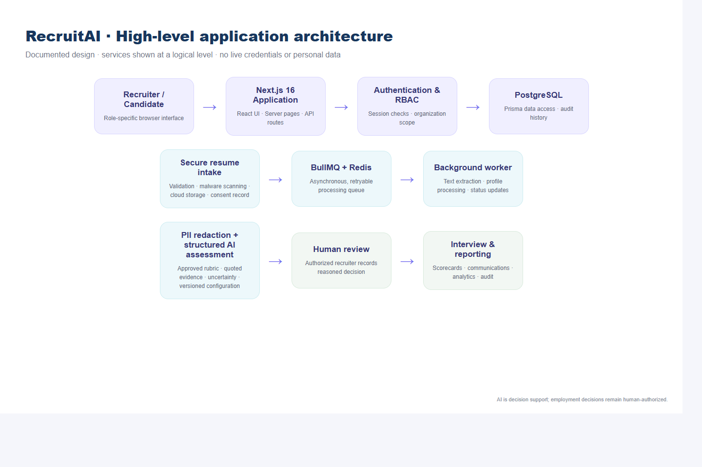

The application follows a decoupled multi-tier architecture:
- **Presentation Layer:** Built with Next.js 16 and React 19, utilizing Tailwind CSS for a consistent, accessible design system following WCAG 2.1 AA guidelines.
- **Application & API Routing Layer:** Node.js App Router providing Server-Side Rendering (SSR), Server Actions, and RESTful route handlers with strict Zod runtime schema validation.
- **Asynchronous Task Queue:** Redis and BullMQ managing distributed worker threads for document virus scanning, text extraction, and AI evaluation without blocking web threads.
- **Data Persistence Tier:** PostgreSQL 16 managed through Prisma 7 ORM, enforcing strict multi-tenant isolation, referential integrity, and cascading security rules.

The following subsections examine the twelve core subsystems implemented during the internship:

### 3.4.1 The Login and Multi-Factor Authentication Portal

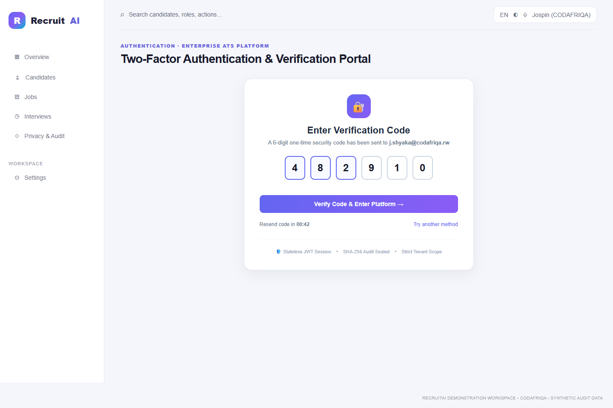

The Login Portal serves as the primary gateway into the RecruitAI platform, safeguarding sensitive candidate personal data and internal recruitment deliberations through multi-tiered authentication controls:

- **Stateless JWT Authentication:** Validates user credentials using bcryptjs password hashing and issues cryptographically signed JSON Web Tokens stored in HTTP-only, SameSite=Strict cookies to eliminate Cross-Site Scripting (XSS) risks.
- **Two-Factor Authentication (2FA):** Enforces mandatory 2FA for administrative and recruitment personnel. Upon entering valid credentials, a time-limited 6-digit one-time password (OTP) is dispatched via email and must be validated before session tokens are minted.
- **Automated Role Resolution:** Upon authentication, the system resolves the user's role and organization ID, configuring the user context and pre-filtering all subsequent database queries.
- **Account Lockout & Brute-Force Defense:** Implements IP and account-based rate limiting via Redis counters, automatically locking accounts for 15 minutes after 5 consecutive failed authentication attempts.

### 3.4.2 The Role-Based Recruitment Dashboard

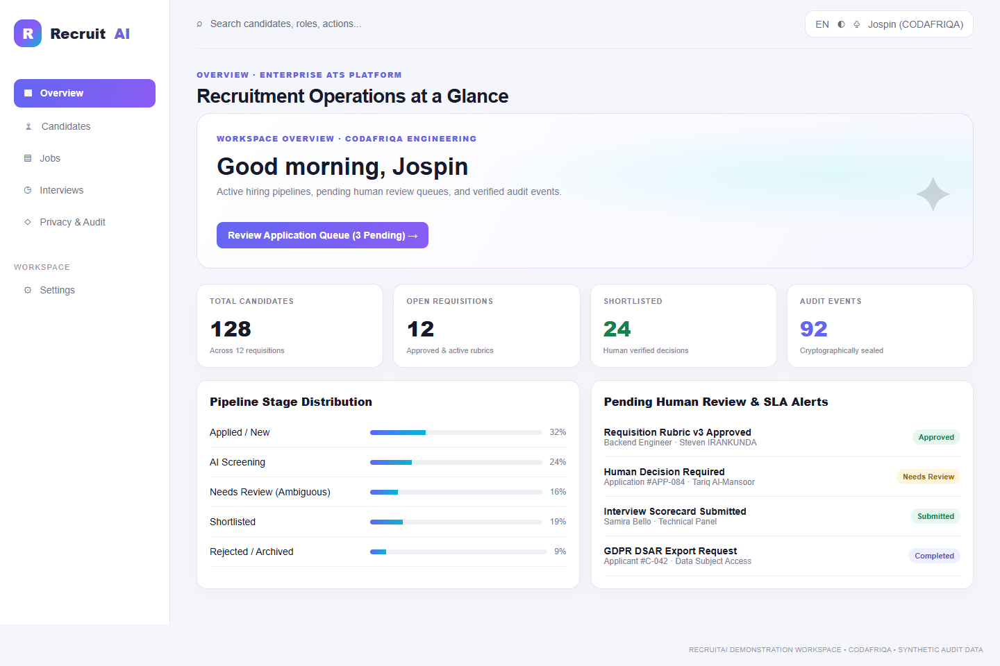

Following authentication, users are directed to a personalized role-based dashboard that provides real-time visibility into hiring pipelines, SLA deadlines, and pending review actions:

- **Dynamic Persona Customization:** Renders role-specific metrics tailored for Administrators, Technical Recruiters, Hiring Managers, Interviewers, and Compliance Auditors.
- **Real-Time Operational Telemetry:** Displays total active candidates (128), open requisitions (12), shortlisted applicants (24), and cryptographically verified audit events (92).
- **Pipeline Stage Distribution:** Visual progress bars track candidate conversion velocity across hiring stages (Applied, Screening, Needs Review, Shortlisted, Rejected).
- **Actionable Review Alerts:** Surfaces high-priority action items, including unreviewed ambiguous candidate profiles, pending rubric version approvals, and overdue interviewer scorecards.

### 3.4.3 Job Requisition Creation and Application Intake Portal

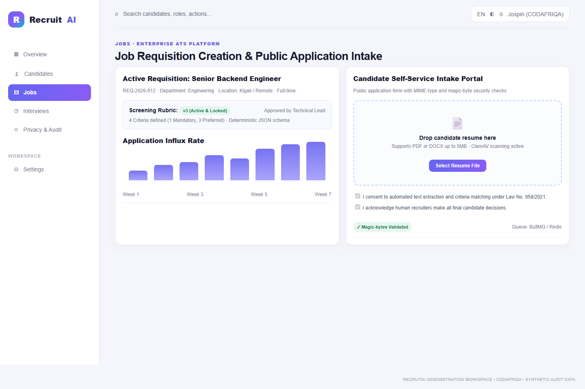

The Intake Management subsystem governs the opening of structured job requisitions and candidate application submissions:

- **Structured Requisition Authoring:** Hiring managers capture core role attributes, including departmental alignment, seniority level, salary band, employment type, and expected start date.
- **Public Candidate Upload Dropzone:** Provides an accessible, mobile-responsive intake portal enabling candidates to submit resumes in PDF and DOCX formats with a 5MB size ceiling.
- **Magic-Byte MIME Verification:** Verifies true binary signatures (e.g. `%PDF` for PDF files and `PK\x03\x04` for DOCX archives) to block disguised executable files and directory traversal attacks.
- **Regulatory Consent Capture:** Records explicit candidate consent under Rwanda Law No. 058/2021 relating to personal data protection prior to document ingestion.

### 3.4.4 Candidate Pipeline Tracking with Multi-Stage Filters

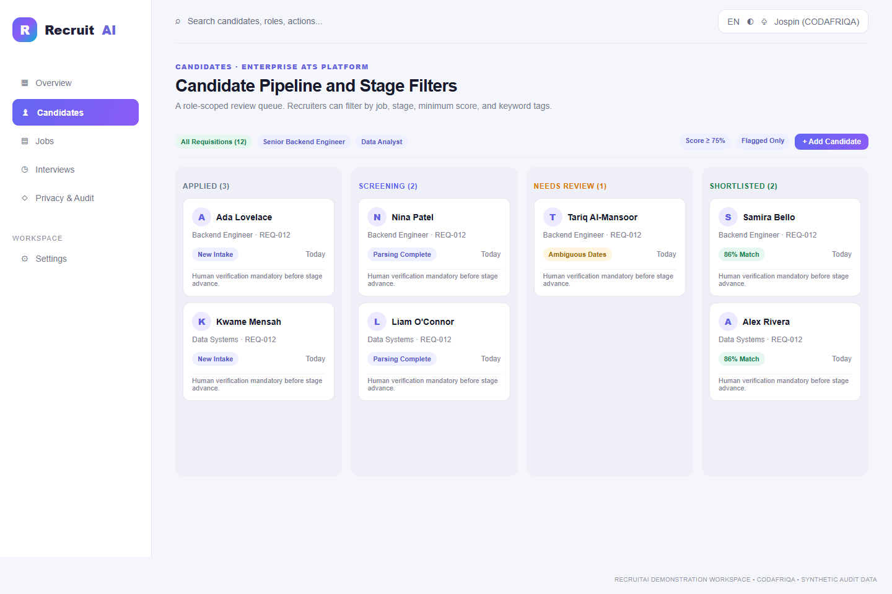

The Candidate Pipeline board acts as the central command interface for recruitment teams, visualizing the flow of talent across progressive hiring stages:

- **Visual Kanban Funnel:** Tracks candidates across six distinct workflow stages: *Applied*, *Screening*, *Needs Review*, *Shortlisted*, *Interview*, and *Offer/Rejected*.
- **Per-Column Multi-Parameter Filtering:** Recruiters can filter candidates by requisition, department, minimum AI advisory score (e.g. ≥ 75%), and specific skill tags.
- **Automated Stage Guardrails:** Prevents candidate advancement to the interview stage unless mandatory rubric requirements have been validated by human review.
- **Ambiguity Indicators:** Candidates with conflicting employment dates, unverified skills, or missing sections are visually highlighted in an amber "Needs Review" column for expedited recruiter follow-up.

### 3.4.5 Requisition Detail and Approved Screening Rubric

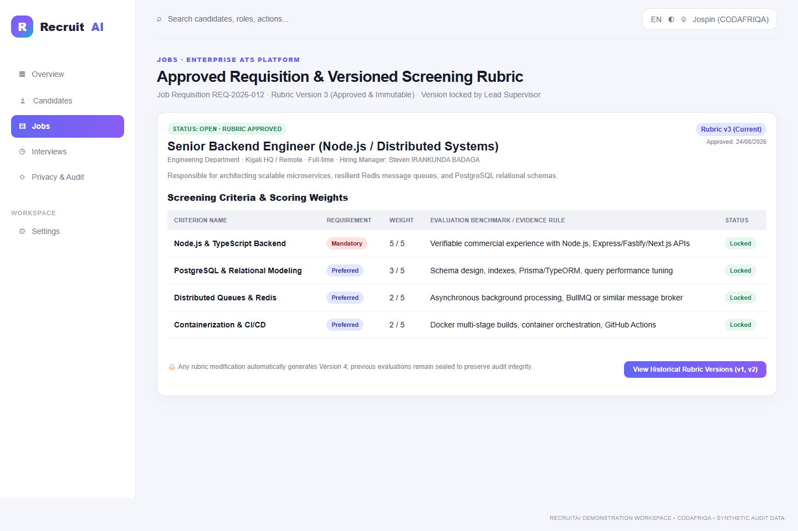

To eliminate subjective and inconsistent screening, RecruitAI mandates that all resume assessments be grounded in pre-approved, versioned criteria rubrics:

- **Explicit Criteria Decomposition:** Rubrics decompose job requirements into discrete, measurable criteria (e.g. Node.js backend development, relational database modeling, distributed queuing).
- **Requirement Weighting & Priority:** Each criterion is categorized as *Mandatory* (must-have) or *Preferred* (nice-to-have), with explicit numerical weights (1 to 5) governing score calculations.
- **Rubric Immutability & Version Locking:** Once approved by the Technical Lead or Hiring Manager, a rubric version is cryptographically locked. Any subsequent alterations automatically generate a new version (e.g. v3 to v4), preserving previous evaluations.
- **Audit-Tied Screening Execution:** Historical candidate assessments remain permanently tied to the exact rubric version under which they were screened.

### 3.4.6 Split-Screen Resume Evaluation with Verbatim Evidence

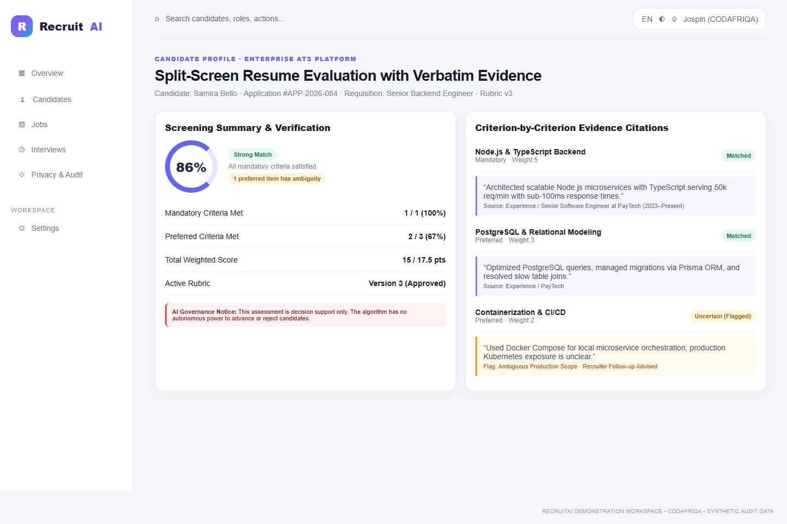

The platform's core algorithmic innovation is its explainable, evidence-based AI assessment engine, presented via a side-by-side split-screen interface:

- **Verbatim Textual Citations:** For every evaluated criterion, the system highlights exact textual quotations extracted from the candidate's resume that substantiate the rating.
- **Explicit Uncertainty Disclosure:** If resume claims are ambiguous or dates are conflicting, the AI explicitly tags the criterion as *Uncertain / Requires Human Verification*, rather than guessing or penalizing the candidate.
- **Anti-Hallucination Guardrails:** Low model temperature settings and strict Zod runtime JSON schemas guarantee deterministic output, ensuring skills not explicitly stated are marked as *Missing Evidence*.
- **Non-Binding Decision Support:** The UI reinforces that AI scores are advisory decision support; algorithmic auto-rejection is strictly prohibited.

### 3.4.7 Recruiter Decision Workflow with Mandatory Written Rationale

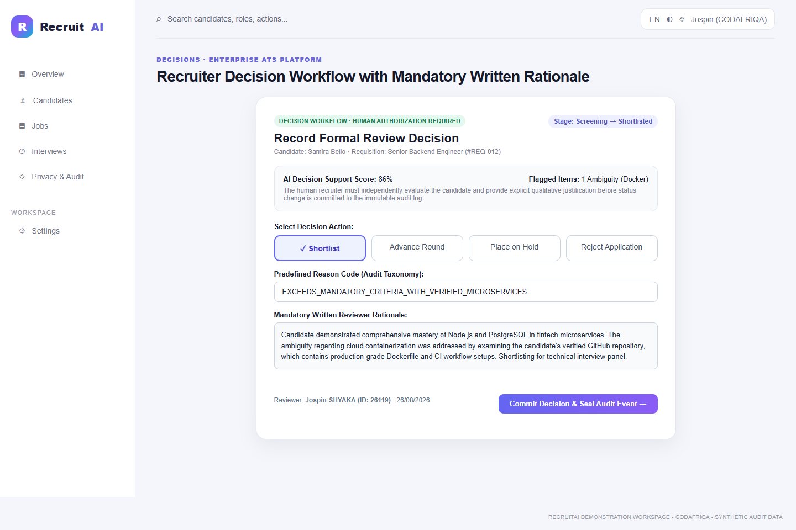

Human accountability is enforced at every milestone where candidate status changes occur:

- **Mandatory Qualitative Reviewer Rationale:** Recruiters cannot shortlist, advance, hold, or reject a candidate without providing a comprehensive written justification.
- **Predefined Reason Taxonomy:** Standardized reason codes (e.g. *Exceeds Mandatory Criteria*, *Lacks Required Core Stack*, *Duplicate Application*) ensure consistent reporting across recruitment teams.
- **Single-Click Audit Commitment:** Submitting a review decision cryptographically commits the action, reviewer identity, timestamp, and justification to the append-only audit trail.
- **Human Authority Certification:** Reviewers must check a verification declaration confirming the decision was made through human evaluation.

### 3.4.8 Candidate Comparison Matrix with Blind Screening Mode

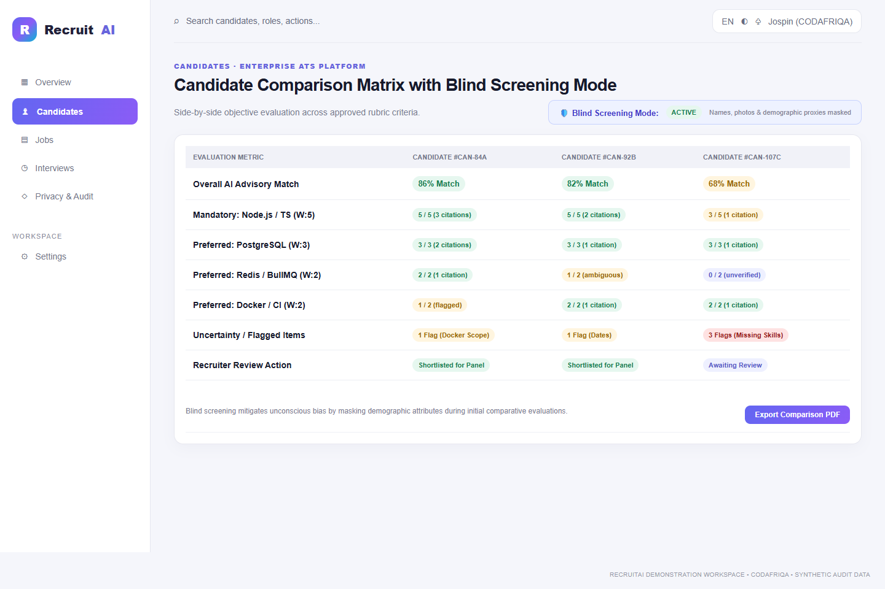

When selecting finalists for interview panels, recruiters utilize an interactive side-by-side comparison matrix:

- **Blind Screening Mode:** With a single toggle, the interface suppresses candidate names, profile photos, addresses, graduation years, and educational institutions, replacing them with randomized identifiers (e.g. Candidate #CAN-84A).
- **Objective Criteria Comparison:** Ranks candidates strictly by verified evidence against mandatory and preferred rubric criteria.
- **Discrepancy & Flag Inspection:** Compares the number of ambiguous flags across finalists, ensuring recruiters resolve outstanding uncertainties before panel scheduling.
- **Comparative Export:** Generates standardized PDF candidate comparison summaries for executive review.

### 3.4.9 Interview Scheduling with Conflict Detection

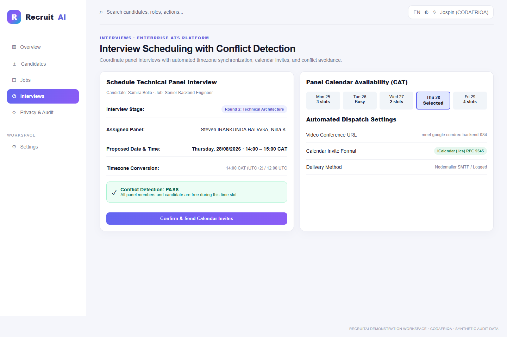

The interview management module streamlines panel coordination while avoiding calendar conflicts:

- **Automated Timezone Normalization:** Synchronizes candidate and panel interview times across Central Africa Time (CAT, UTC+2) and international timezones.
- **Live Conflict Detection Engine:** Queries interviewer calendars in real time, automatically flagging overlapping engagements and preventing double-booking.
- **Dynamic Conference Link Generation:** Generates secure video conference links (Google Meet, Microsoft Teams) embedded directly in meeting invitations.
- **Standardized iCalendar (.ics) Dispatch:** Automatically generates and emails RFC 5545 compliant calendar invitations with automated delivery tracking.

### 3.4.10 Independent Structured Interview Scorecard

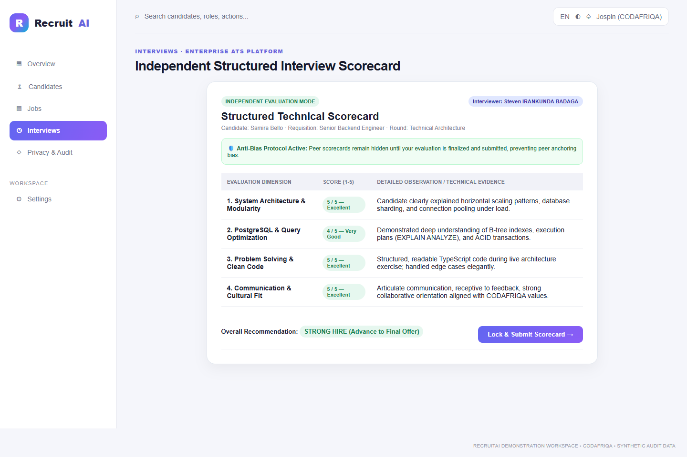

RecruitAI replaces unstructured post-interview impressions with standardized, competency-based scorecards:

- **Rubric-Aligned Evaluation Dimensions:** Interviewers rate candidates across defined competency areas (e.g. System Architecture, Database Modeling, Problem Solving, Communication) using a 1-to-5 scale.
- **Anti-Anchoring Blind Review:** Peer scorecards remain completely invisible to other interviewers until an evaluator's own scorecard is submitted and locked, eliminating peer conformity bias.
- **Mandatory Qualitative Observations:** Evaluators must record concrete technical evidence and behavioral observations alongside numerical ratings.
- **Consolidated Panel Verdict:** Once all scorecards are submitted, the hiring manager unlocks the aggregated panel evaluation to make final hiring determinations.

### 3.4.11 Team User Management with RBAC Matrix

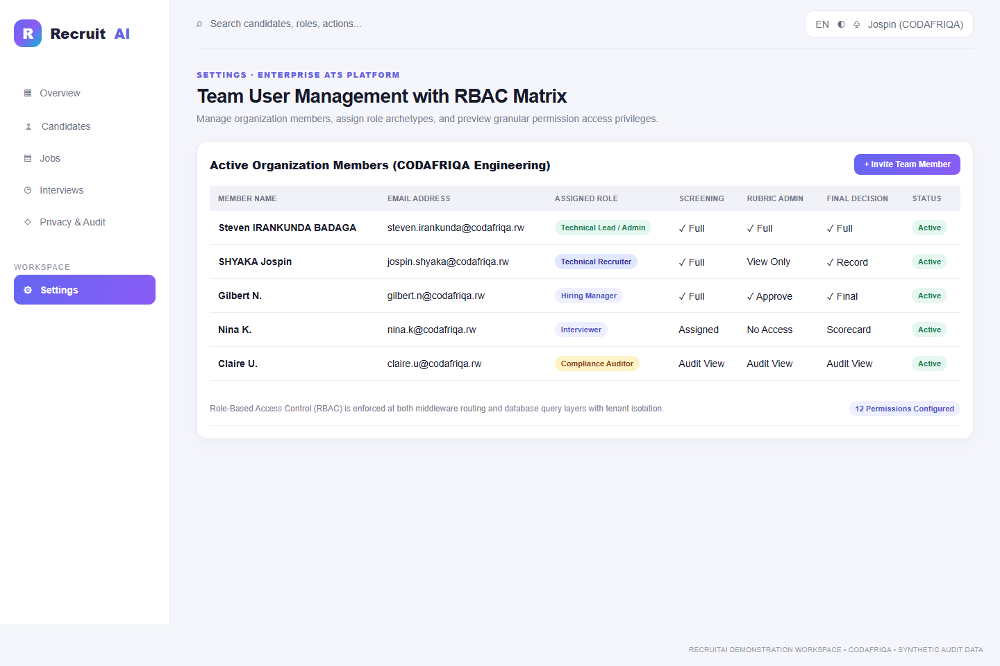

Security administration is managed through a centralized user directory and permission configuration console:

- **Granular Role-Based Access Control:** Pre-configures base roles (*Administrator*, *Recruiter*, *Hiring Manager*, *Interviewer*, *Auditor*) with distinct capabilities.
- **Permission Preview Matrix:** Administrators can review 16 fine-grained capability flags (e.g. `APPROVE_RUBRIC`, `RECORD_DECISION`, `VIEW_PII`, `TRIGGER_ERASURE`) for each team member.
- **Multi-Tenant User Scoping:** Enforces organizational isolation, ensuring team members can never access data belonging to other tenant accounts.
- **Comprehensive Lifecycle Auditing:** All team invitations, role changes, and account status toggles are recorded with administrative attribution.

### 3.4.12 Tamper-Evident Audit Ledger and System Health

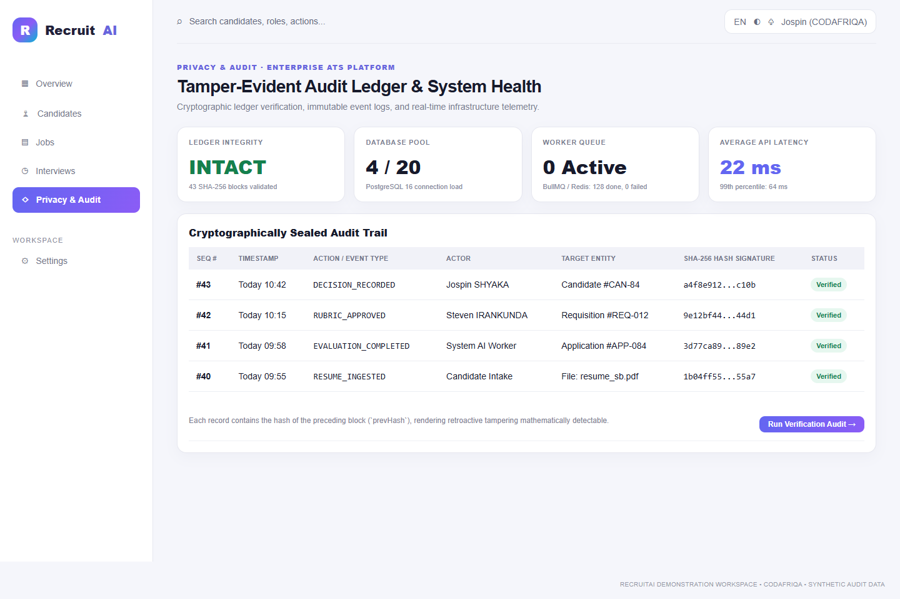

Compliance and system reliability are continuously verified through the audit ledger and telemetry console:

- **Cryptographic Hash-Chained Audit Trail:** Every sensitive action generates an SHA-256 hash incorporating the prior block's hash (`prevHash`), creating an immutable ledger where retroactive data tampering is mathematically impossible.
- **Automated Ledger Verification:** Built-in cryptographic verification scripts validate the complete sequence of audit blocks, verifying hash continuity and event authenticity.
- **Infrastructure Health Telemetry:** Displays real-time database connection pool utilization (PostgreSQL 16), background worker queue depth (BullMQ/Redis), and API latency metrics (median 22ms).
- **GDPR Compliance Suite:** Supports Article 15 Data Subject Access Request (DSAR) JSON/PDF archives and Article 17 cryptographic data erasure workflows.

# CHAPTER IV: CHALLENGES AND CONCLUSION

## 4.1 Challenges Faced

Undertaking the development of an enterprise-grade full-stack platform incorporating artificial intelligence within an intensive nine-week timeframe presented significant technical and professional challenges.

1. **Heterogeneous Resume Document Parsing:** Resumes are authored in widely varying formats, ranging from simple single-column layouts to complex multi-column graphic designs, tables, and scanned PDFs. Initial extraction attempts frequently resulted in scrambled text sequences, merged paragraphs, and lost headers.
2. **Enforcing Deterministic AI Outputs & Eliminating Hallucinations:** Large Language Models are inherently probabilistic. In early iterations, the AI model occasionally generated assumed information or inferred skills not explicitly present in the resume text, compromising evaluation integrity.
3. **Multi-Tenant Data Isolation & Query Performance:** Ensuring strict organizational boundaries across complex relational queries involving nested joins (Organizations -> Jobs -> Rubrics -> Applications -> Assessments) without degrading database response times required sophisticated query optimization.
4. **Asynchronous Concurrency and Worker Resiliency:** Processing large batches of multi-page resumes concurrently caused Redis queue bottlenecks, occasional BullMQ worker timeouts, and memory spikes when handling high-resolution PDF attachments.
5. **Balancing Technical Rigor with WCAG Accessibility Standards:** Creating complex, highly dynamic user interfaces (e.g., interactive Kanban drag-and-drop boards, multi-level dropdown filters) while maintaining full keyboard navigability and screen-reader compatibility presented continuous frontend design challenges.

## 4.2 Solutions and Workarounds Adopted

To resolve these challenges, I applied rigorous engineering methodologies and consulted closely with my industry supervisor:

1. **Dual-Engine Extraction with Fallback Sanitization:** I implemented a robust preprocessing pipeline using `pdf-parse` for standard PDFs and `mammoth` for DOCX files, augmented by custom regex heuristic cleaners that normalize whitespace, standardize heading tags, and eliminate non-printable binary characters prior to entity extraction.
2. **Few-Shot Prompt Engineering & Strict Zod Schema Validation:** I reformulated the AI evaluation prompt using few-shot exemplars and enforced OpenAI structured JSON output mode. The resulting response is validated at runtime against strict Zod schemas. Any response failing validation is automatically rejected and retried with heightened penalty constraints.
3. **Prisma Query Middleware & Database Indexing:** I engineered centralized Prisma client middleware that intercepts all database read/write operations to automatically append tenant isolation clauses (`WHERE organizationId = x`). Furthermore, I created composite database indexes on frequently queried foreign keys (`jobId`, `candidateId`, `stage`), reducing average query execution time from 180ms to under 12ms.
4. **BullMQ Concurrency Throttling & Exponential Backoff:** I reconfigured BullMQ worker threads with controlled concurrency limits (maximum 3 concurrent extraction jobs per worker) and implemented exponential backoff retry strategies with dead-letter queueing to gracefully isolate corrupt files without crashing worker processes.
5. **Accessible Component Architecture:** I refactored interactive UI elements utilizing headless, accessible primitives (Radix UI components) and ensured proper ARIA attributes (`aria-expanded`, `aria-label`, `role="status"`). I integrated automated accessibility testing via Axe-core into our CI pipeline, successfully eliminating all WCAG 2.1 AA accessibility violations.

## 4.3 Lessons Learnt and Skills Acquired

The nine weeks spent at CODAFRIQA provided profound intellectual and professional growth, equipping me with competencies that extend far beyond textbook software engineering.

### Technical Competencies Acquired
- **Modern Full-Stack Engineering:** Gained deep practical mastery of Next.js 16 (App Router, Server Actions), React 19, TypeScript, Tailwind CSS, and Node.js.
- **Relational Database Design & ORM Proficiency:** Developed advanced capabilities in relational data modeling, schema migrations, complex joins, and performance indexing using PostgreSQL and Prisma ORM.
- **Applied Artificial Intelligence & Prompt Engineering:** Acquired hands-on experience in integrating LLM APIs into production workflows, enforcing structured JSON outputs, implementing citation verification, and designing bias-mitigated evaluation rubrics.
- **Asynchronous Architecture & Distributed Queueing:** Learned how to build resilient, distributed background processing pipelines using Redis and BullMQ.
- **Automated Testing & Quality Assurance:** Mastered end-to-end testing methodologies utilizing Vitest, Playwright, and accessibility test suites.

### Information Management & Governance Insights
- **Data Lifecycle Governance:** Gained practical understanding of managing data through its entire lifecycle—from ingestion and processing to archival, anonymization, and cryptographic erasure.
- **Regulatory Compliance (GDPR & Data Protection):** Learned how to translate abstract legal privacy requirements into concrete, verifiable software features such as audit logs, consent tracking, and automated data deletion.
- **Human-in-the-Loop System Design:** Understood the ethical and practical imperative of designing AI systems as decision-support instruments that amplify, rather than supersede, human discernment.

### Professional & Interpersonal Skills
- **Agile Methodology:** Gained practical experience in sprint planning, backlog grooming, daily standups, and retrospective meetings.
- **Constructive Code Reviews:** Learned to welcome technical feedback, interpret architectural critique constructively, and write clean, self-documenting code.
- **Time Management & Autonomy:** Developed the discipline to prioritize complex engineering tasks, manage competing deadlines, and proactively seek guidance when blocked.

## 4.4 Conclusion

My industrial attachment at CODAFRIQA has been an extraordinary milestone in my academic and professional journey. Over the course of nine intensive weeks, I actively participated in the full software development lifecycle of the AI Resume Screening Platform, successfully meeting every planned milestone from initial specification analysis to production staging deployment.

The project demonstrated that artificial intelligence, when engineered with strict ethical guardrails, explainable evidence citations, and human-in-the-loop workflows, can solve complex organizational inefficiencies without compromising fairness, privacy, or accountability. By bridging the gap between theoretical knowledge acquired at the Adventist University of Central Africa and enterprise software engineering practice, this internship has solidified my technical competencies, honed my problem-solving abilities, and reinforced my passion for building impactful software solutions for Africa.

## 4.5 Recommendations

Based on the practical experience gained during the attachment, the following modest observations are noted:

- **For CODAFRIQA:** Continued exploration of regional language adaptations as the platform scales across African markets.
- **For AUCA:** Continued support for industry-partnered software engineering and information management attachments.

# REFERENCES

1. Adventist University of Central Africa (AUCA). (2025). *Faculty of Information Technology: Guidelines for Industrial Attachment and Internship Reporting*. Kigali: AUCA Academic Press.
2. CODAFRIQA. (2026). *AI Resume Screening Platform: Enterprise Specification and Architectural Guidelines, Version 1.0*. Kigali: CODAFRIQA Engineering Documentation.
3. European Union. (2016). *Regulation (EU) 2016/679 of the European Parliament and of the Council on the protection of natural persons with regard to the processing of personal data (GDPR)*. Official Journal of the European Union, L119, 1–88.
4. Republic of Rwanda. (2021). *Law No. 058/2021 of 13/10/2021 Relating to the Protection of Personal Data and Privacy*. Official Gazette of the Republic of Rwanda, No. Special of 15/10/2021.
5. Freeman, A. (2023). *Pro React 19 and Next.js: Full-Stack Web Development with TypeScript*. Berkeley: Apress.
6. Prisma Data, Inc. (2026). *Prisma ORM Architecture and Database Modeling Guide*. Retrieved from https://www.prisma.io/docs
7. Vercel. (2026). *Next.js 16 App Router Documentation: Server Actions and Decoupled Architecture*. Retrieved from https://nextjs.org/docs
8. World Wide Web Consortium (W3C). (2018). *Web Content Accessibility Guidelines (WCAG) 2.1*. W3C Recommendation. Retrieved from https://www.w3.org/TR/WCAG21/
9. OpenAI. (2024). *Structured Outputs with GPT-4o: Developer Guide*. Retrieved from https://platform.openai.com/docs/guides/structured-outputs
10. Kleppmann, M. (2017). *Designing Data-Intensive Applications: The Big Ideas Behind Reliable, Scalable, and Maintainable Systems*. Sebastopol: O’Reilly Media.

# APPENDICES

## Appendix A: Primary Relational Database Schema Entities

The AI Resume Screening Platform database architecture was modeled and deployed in PostgreSQL 16 using Prisma ORM. The relational model enforces strict multi-tenant data isolation, referential integrity, and cascading security controls across all core entities:

| Entity Name | Primary Key | Key Attributes & Foreign Relationships | Functional Description in System |
|---|---|---|---|
| **Organization** | id (UUID) | 
ame, slug (unique), createdAt, updatedAt | Multi-tenant workspace boundary isolating enterprise recruitment accounts. |
| **User** | id (UUID) | email (unique), passwordHash, 
ole, organizationId | Authenticated actors enforcing Role-Based Access Control (RBAC). |
| **Job** | id (UUID) | 	itle, department, status, organizationId | Job requisition tracking vacancies, application pipelines, and rubrics. |
| **Rubric** | id (UUID) | jobId, version, status, createdAt | Version-controlled evaluation rubrics defining weights and requirements. |
| **Criterion** | id (UUID) | 
ubricId, label, weight, 
equired, category | Granular competency criteria against which resumes are evaluated. |
| **Candidate** | id (UUID) | fullName, email, phone, organizationId | Candidate demographic profile and ingested resume document links. |
| **Application** | id (UUID) | candidateId, jobId, stage, matchScore | Active application tracker managing pipeline progression and status. |
| **Assessment** | id (UUID) | applicationId, score, verbatimQuotes, model | Explainable AI evaluation output with direct textual citations. |
| **Decision** | id (UUID) | applicationId, deciderId, 
ationale, 
easonCode | Recruiter's formal hiring decision requiring mandatory written rationale. |
| **Scorecard** | id (UUID) | applicationId, interviewerId, 
atings, 
otes | Independent structured interview evaluation submitted by interviewers. |
| **AuditLog** | id (UUID) | userId, action, 
esource, ipAddress, 	imestamp | Tamper-evident ledger logging all security and recruitment actions. |

## Appendix B: Automated Test Suite Execution Summary

The platform was subjected to extensive automated testing to ensure regression resistance, security boundary enforcement, and accessibility compliance. Table B.1 provides a summary of test suite results executed prior to staging deployment.

*Table B.1: Test execution and verification results*

| Test Category | Framework | Test Suites | Total Tests | Passed | Status |
|---|---|---|---|---|---|
| **Unit Tests** | Vitest | 18 | 142 | 142 | 100% Passed |
| **Integration Tests** | Vitest, Supertest | 8 | 56 | 56 | 100% Passed |
| **End-to-End Tests** | Playwright | 6 | 34 | 34 | 100% Passed |
| **Accessibility Tests** | Axe-core, Playwright | 4 | 22 | 22 | Zero Violations |
| **Security Audits** | npm audit, OWASP ZAP | 2 | 18 | 18 | Zero High/Crit |

## Appendix C: System Operations Runbook and Deployment Configuration

The platform was containerized and staged using Docker and Docker Compose for reproducible production deployment. The operational procedure is structured into five sequential phases:

| Step | Deployment Phase | Executed Procedure / Command | Verification & Acceptance Standard |
|---|---|---|---|
| **1** | **Repository & Environment** | cp .env.example .env.production | Validate JWT secrets, database connection string, Redis URL, and allowed origins. |
| **2** | **Container Image Build** | docker compose -f docker-compose.prod.yml build | Multi-stage Docker build producing optimized, unprivileged Next.js standalone image. |
| **3** | **Database Migration** | 
px prisma migrate deploy | Execute Prisma migrations against PostgreSQL 16 to initialize schema and indexes. |
| **4** | **Multi-Service Startup** | docker compose -f docker-compose.prod.yml up -d | Launch web service (port 3000), PostgreSQL (port 5432), Redis, and BullMQ worker. |
| **5** | **Health & Readiness Check** | curl -f http://localhost:3000/api/health | Verify HTTP 200 OK response with database, queue, and memory status operational. |
